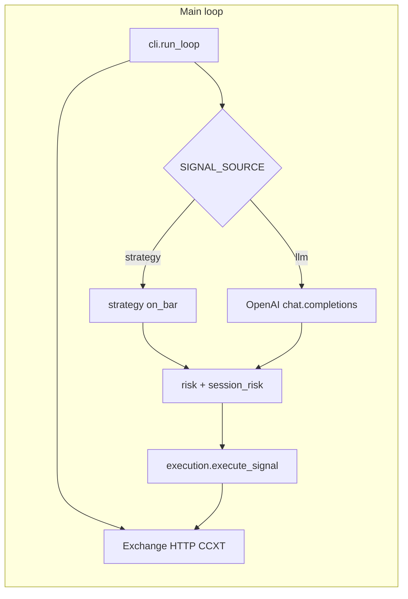

# Architecture

This document is a concise map of the **futures-llm-bot** package: how data flows, where risk lives, and how modules relate.

## High-level flow

1. **`cli`** waits for the next candle boundary (unless `--once`), then runs one **tick**.
2. **Tick**: reads futures USDT balance and positions. Builds **OHLCV** from **`exchange.fetch_ohlcv`** or, when **`USE_WEBSOCKET=true`** (strategy mode, optional **`realtime`** extra), from **`binance_kline_ws.BinanceUsdMKlineBuffer`** (REST seed + **closed** kline frames; exponential backoff on disconnect; may fall back to REST if the deque is short). Then **`SIGNAL_SOURCE=strategy`** runs **`strategy_factory` → `on_bar` → `LLMSignal`**, or **`SIGNAL_SOURCE=llm`** runs **`llm_strategy.llm_decide`** on a prompt (with retries on transient API errors).
3. After a signal is built, **`telegram_notify.send_telegram_trade_signal`** may send a **templated** Bot API message if tokens/chat id are configured (before risk gating).
4. **`risk.assess_signal`** gates confidence and size for directional trades (`flat`/`hold` exempt as before).
5. **`session_risk`** enforces optional daily trade count and drawdown vs day-start equity (UTC); blocks new long/short only.
6. **`execution`** branches on **one-way vs hedge** mode and places orders via **`order_utils.place_order`** (optional **`metrics.record_real_order`** callback on real submits).

## Module layout

| Module | Role |
|--------|------|
| `config.Settings` | Env-backed configuration (Pydantic); validates symbol, OpenAI base URL, and strategy params. |
| `positions` | Parse CCXT positions into `PositionLegs`, mark price, account context string. |
| `order_utils` | Notional→amount, min lot/cost checks, position poll after reduce-only, place order. |
| `execution_oneway` / `execution_hedge` | Order sequencing and caps per mode. |
| `execution` | `build_exchange`, `resolve_account_hedged`, `execute_signal` (orchestration). |
| `llm_strategy` | System prompt, JSON extraction, OpenAI client with backoff (when `SIGNAL_SOURCE=llm`). |
| `strategy_factory` | Builds rule strategies (SMA, RSI, MACD, Bollinger, Ichimoku-style, Fib reclaim, volume-profile POC, Stochastic, ATR breakout, **ML**, **composite**, **rsi_adaptive**, **rl_sb3**) when `SIGNAL_SOURCE=strategy`. |
| `ml_signal_strategy` | Optional **TorchScript** / **Keras** on **log-returns**; **`ML_HOT_RELOAD`** rechecks `ML_MODEL_PATH` mtime on each bar (throttled) and reloads on change. |
| `rl_signal_strategy` | Optional **Stable-Baselines3** `BaseAlgorithm.load`; observation = clipped **log-returns** of length **`RL_WINDOW-1`** (matches training). |
| `rl/` | **`FuturesPerpBarEnv`** (Gymnasium): discrete position, reward modes for **`examples/train_rl_sb3.py`** (requires **`.[rl]`**). |
| `composite_strategy` | Voting / weighted / unanimity / first-non-hold merge of child **`Strategy`** instances. |
| `risk_metrics` | Log returns, historical VaR quantile, rolling vol helpers, return correlation; used by **`cli`** VaR gate and **`var_validation`**. |
| `var_validation` | Rolling historical VaR **violation** counts and **Kupiec** unconditional coverage LR (~ χ²(1)). |
| `var_validation_cli` | Console **`futures-llm-var-validate`** (`--csv` or `--fetch`). |
| `binance_kline_ws` | Optional WebSocket consumer: **`reconnect_delay_sec`**, thread **`WebSocketApp`** loop, in-memory OHLCV deque. |
| `telegram_format` / `telegram_notify` | Named/custom **`str.format`** templates; JSON **`sendMessage`** + optional **`parse_mode`**. |
| `real_pnl` / `real_pnl_cli` | Fetch Binance USDT-M `/fapi/v1/income`, aggregate REALIZED_PNL / FUNDING_FEE / COMMISSION (exchange-reported). |
| `risk` | Per-signal min confidence and size checks. |
| `session_risk` | Persisted UTC-day counters; `filelock` on state file for multi-process safety. |
| `metrics` | In-process counters for ticks, LLM latency, real orders. |
| `observability` | Optional daemon HTTP: **`/` / `/dashboard`** (HTML UI polling `/health`), **`/health`**, **`/metrics`**. |
| `constants` | Shared epsilons and sane price bounds. |
| `backtest/` | Rule strategies + `run_backtest` on OHLCV (CSV or CCXT fetch); see `futures-llm-backtest` CLI. |

## Backtest (route 1: rules + history)

- **`backtest/engine.py`**: bar walk, **close-to-close** fills, fee on traded notional (`fee_bps`), equity ≈ `cash + signed_position * close` (teaching linear-perp approximation).
- **`backtest/indicators.py`**: NumPy **vectorized** series (SMA/EMA/RSI/MACD/Bollinger, Ichimoku helpers, Fib levels, volume-profile POC, **Stochastic**, **Wilder ATR**, true range) and **incremental streams** for core indicators (O(1) per bar when the close prefix grows by one row where implemented).
- **`backtest/strategies.py`**: Rule classes above plus **Ichimoku**, **Fib**, **VP**, **Stochastic**, **ATR breakout** → **`LLMSignal`**.
- **`backtest/data.py`**: `load_ohlcv_csv`, `fetch_ohlcv_ccxt`, **`fetch_ohlcv_ccxt_paginated`** (Binance `endTime` paging for long history).
- **CLI**: `futures-llm-backtest --strategy … --csv path` or `--fetch …` (see `--help`; includes **ML** flags and extended params).
- **`examples/train_ml_torch.py`**: Illustrative **MLP/LSTM/Mini-Transformer** training + **TorchScript** export (not production labels).

This path is **deterministic** and suitable for walk-forward and parameter sweeps; it does **not** call the LLM.

## ML lifecycle (live vs training)

- **Training:** `examples/train_ml_torch.py` reads **`--csv`** or paginated **`--fetch`** (see **`backtest/data.fetch_ohlcv_ccxt_paginated`**), then exports TorchScript to a path you later assign to **`ML_MODEL_PATH`**.
- **Live:** `ml_signal_strategy` loads at startup; with **`ML_HOT_RELOAD`**, it compares **`ML_MODEL_PATH`** `st_mtime_ns` every **`ML_HOT_RELOAD_INTERVAL_SEC`** and reloads on change (failed reload keeps prior weights).
- **Backtest:** ML strategies default to **`ml_hot_reload=false`** so runs stay reproducible; CLI backtests do not consult live env hot-reload toggles unless you wire them explicitly.
- **Scheduled deploy:** retrain jobs should write **`${MODEL_OUT}.tmp`** then **`mv`** onto **`ML_MODEL_PATH`** so readers see either the old or new file, never a partial write.

## RL (optional `rl` extra)

- **`rl/futures_perp_env.py`**: Gymnasium **Env** with **Box(`window-1`)** clipped log-return observations and **Discrete(3)** actions mapping to net position **{0,+1,-1}**. Rewards: **`pnl`**, **`pnl_cost`** (turnover penalty), **`risk_adjusted`** (drawdown penalty on a simple log-equity trace).
- **`examples/train_rl_sb3.py`**: Loads **CSV** / **paginated `--fetch`** / synthetic prices, wraps **`DummyVecEnv`**, trains **PPO** (hyperparameters via CLI), **`model.save`** → zip used as **`RL_MODEL_PATH`** for **`STRATEGY_NAME=rl_sb3`**.
- **`rl_signal_strategy.py`**: **`BaseAlgorithm.load`** and **`predict`**; must match **`RL_WINDOW`** and action semantics used in training.

## VaR validation (offline)

- **`var_validation.py`**: For each forecast index `t`, VaR = empirical **`alpha`** quantile of **prior `lookback` log returns**; **violation** if realized **`r[t] < VaR`**. Reports rate and **Kupiec** LR (simple unconditional coverage test — not sufficient under volatility clustering).
- **`var_validation_cli.py`**: **`futures-llm-var-validate`** shares data loading patterns with **`backtest_cli`** (`--csv` / `--fetch`).
- **Live gate:** **`cli._tick`** may block **LONG/SHORT** when **`RISK_VAR_BLOCK`** and trailing-window VaR breaches **`RISK_VAR_TAIL_LIMIT`** (see **`risk_metrics.var_tail_block_reason_from_ohlcv`**).

## Observability

When **`OBSERVABILITY_PORT` > 0**, a background thread serves:

- **`GET /`** and **`GET /dashboard`**: lightweight HTML UI that polls **`/health`** every few seconds (same origin; no extra deps).
- **`GET /health`**: JSON snapshot from `metrics.snapshot()` (uptime, tick counters, LLM stats, `status`: `healthy` vs `degraded`).
- **`GET /metrics`**: Prometheus exposition format (counters only; no external `prometheus_client` dependency).

Bind address is **`OBSERVABILITY_HOST`** (default `127.0.0.1`). Use a reverse proxy or SSH tunnel if you need remote access.

## State files

- **`STATE_FILE`**: JSON for daily session risk; lock file `STATE_FILE.lock`.
- **Not** storing virtual positions for `DRY_RUN`; dry-run only logs intended orders.

## Extension points

- **New exchange**: Implement the same duck-typed surface as CCXT (`fetch_positions`, `create_order`, `market`, …) or add an adapter.
- **Stricter risk**: Extend `session_risk` or add a layer before `execute_signal`.
- **New strategy (backtest + live)**: Implement `reset` / `on_bar` → **`LLMSignal`**; register in **`strategy_factory.build_strategy_for_backtest`**, **`min_bars_for_backtest`**, **`Settings`** validation, and **`futures-llm-backtest`** choices/args.
- **ML models**: Train offline; match **input rank** (`mlp` vs `lstm`/`transformer`) and **3-class** head to **`ml_signal_strategy`**; export TorchScript with **`torch.jit.trace`** (or compatible).
- **Alerting**: Poll `/health` or scrape `/metrics`; wire to PagerDuty/Slack outside this repo (e.g. Prometheus `alertmanager`, or a tiny cron hitting `/health`).
- **Higher-frequency / multi-symbol / async IO**: Would need **`ccxt.async_support`**, per-symbol state, and scheduling; not in the current single-pair sync loop.
- **RL policies**: Train with **`examples/train_rl_sb3.py`**; keep **`RL_WINDOW`**, observation clipping, and **0/1/2** action semantics aligned with **`FuturesPerpBarEnv`** / **`build_observation_vector`**.
