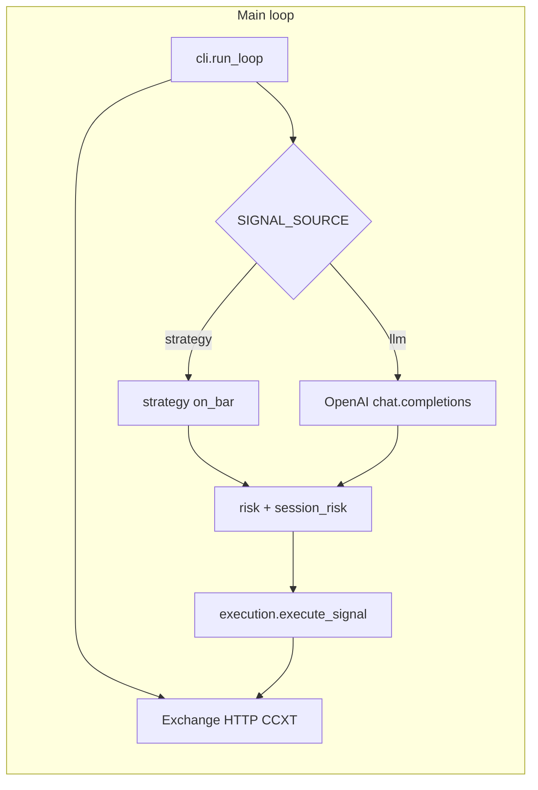

# Architecture

This document is a concise map of the **futures-llm-bot** package: how data flows, where risk lives, and how modules relate.

## High-level flow

1. **`cli`** waits for the next candle boundary (unless `--once`), then runs one **tick**.
2. **Tick**: reads futures USDT balance and positions. If **`SIGNAL_SOURCE=strategy`**, fetches enough OHLCV for **`strategy_factory.build_live_strategy`** (same rule classes as **`futures-llm-backtest`**: **SMA cross**, **RSI**, **MACD**, **Bollinger**) and gets **`LLMSignal`** without the LLM. If **`SIGNAL_SOURCE=llm`**, builds a **prompt** (OHLCV + account context) and calls **`llm_strategy.llm_decide`** (with retries on transient API errors).
3. **`risk.assess_signal`** gates confidence and size for directional trades (`flat`/`hold` exempt as before).
4. **`session_risk`** enforces optional daily trade count and drawdown vs day-start equity (UTC); blocks new long/short only.
5. **`execution`** branches on **one-way vs hedge** mode and places orders via **`order_utils.place_order`** (optional **`metrics.record_real_order`** callback on real submits).

## Module layout

| Module | Role |
|--------|------|
| `config.Settings` | Env-backed configuration (Pydantic); validates symbol, OpenAI base URL, and strategy params. |
| `positions` | Parse CCXT positions into `PositionLegs`, mark price, account context string. |
| `order_utils` | Notional→amount, min lot/cost checks, position poll after reduce-only, place order. |
| `execution_oneway` / `execution_hedge` | Order sequencing and caps per mode. |
| `execution` | `build_exchange`, `resolve_account_hedged`, `execute_signal` (orchestration). |
| `llm_strategy` | System prompt, JSON extraction, OpenAI client with backoff (when `SIGNAL_SOURCE=llm`). |
| `strategy_factory` | Builds rule strategies (`sma_cross`, `rsi`, `macd`, `bollinger` / `bb`) when `SIGNAL_SOURCE=strategy`. |
| `real_pnl` / `real_pnl_cli` | Fetch Binance USDT-M `/fapi/v1/income`, aggregate REALIZED_PNL / FUNDING_FEE / COMMISSION (exchange-reported). |
| `risk` | Per-signal min confidence and size checks. |
| `session_risk` | Persisted UTC-day counters; `filelock` on state file for multi-process safety. |
| `metrics` | In-process counters for ticks, LLM latency, real orders. |
| `observability` | Optional daemon HTTP: **`/` / `/dashboard`** (HTML UI polling `/health`), **`/health`**, **`/metrics`**. |
| `constants` | Shared epsilons and sane price bounds. |
| `backtest/` | Rule strategies + `run_backtest` on OHLCV (CSV or CCXT fetch); see `futures-llm-backtest` CLI. |

## Backtest (route 1: rules + history)

- **`backtest/engine.py`**: bar walk, **close-to-close** fills, fee on traded notional (`fee_bps`), equity ≈ `cash + signed_position * close` (teaching linear-perp approximation).
- **`backtest/strategies.py`**: **`SMACrossStrategy`**, **`RsiThresholdStrategy`**, **`MacdCrossStrategy`**, **`BollingerBandCrossStrategy`** → **`LLMSignal`**.
- **`backtest/data.py`**: `load_ohlcv_csv`, `fetch_ohlcv_ccxt`.
- **CLI**: `futures-llm-backtest --strategy sma_cross|rsi|macd|bollinger|bb --csv path` or `--fetch ...`.

This path is **deterministic** and suitable for walk-forward and parameter sweeps; it does **not** call the LLM.

## Observability

When **`OBSERVABILITY_PORT` > 0**, a background thread serves:

- **`GET /`** and **`GET /dashboard`**: lightweight HTML UI that polls **`/health`** every few seconds (same origin; no extra deps).
- **`GET /health`**: JSON snapshot from `metrics.snapshot()` (uptime, tick counters, LLM stats, `status`: `healthy` vs `degraded`).
- **`GET /metrics`**: Prometheus exposition format (counters only; no external `prometheus_client` dependency).

Bind address is **`OBSERVABILITY_HOST`** (default `127.0.0.1`). Use a reverse proxy or SSH tunnel if you need remote access.

## State files

- **`STATE_FILE`**: JSON for daily session risk; lock file `STATE_FILE.lock`.
- **Not** storing virtual positions for `DRY_RUN`; dry-run only logs intended orders.

## Extension points

- **New exchange**: Implement the same duck-typed surface as CCXT (`fetch_positions`, `create_order`, `market`, …) or add an adapter.
- **Stricter risk**: Extend `session_risk` or add a layer before `execute_signal`.
- **New strategy (backtest + live)**: Implement `reset` / `on_bar` → **`LLMSignal`**; register in **`strategy_factory.build_strategy_for_backtest`** and **`STRATEGY_NAME`**.
- **Alerting**: Poll `/health` or scrape `/metrics`; wire to PagerDuty/Slack outside this repo (e.g. Prometheus `alertmanager`, or a tiny cron hitting `/health`).
- **Higher-frequency / multi-symbol / async IO**: Would need **`ccxt.async_support`**, per-symbol state, and scheduling; not in the current single-pair sync loop.
- **Web dashboard**: Serve or proxy **`/metrics` + `/health`** with Grafana or a static page; optional small FastAPI app alongside the bot.
