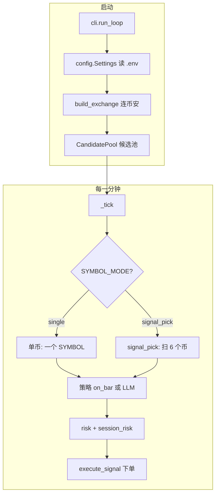

# 初学者如何读懂 binance_auto_ai

> 面向「会一点 Python、没写过交易机器人」的读者。按本文顺序读代码，能覆盖 **80% 日常逻辑**；ML/RL/复杂指标可放到第二阶段。

---

## 1. 这个项目在干什么（一句话）

**每隔 1 分钟**：拉币安 U 本位永续的 K 线和账户 → 用规则（或 AI）决定 **做多 / 做空 / 观望 / 平仓** → 过风控 → 向币安下单（或 `DRY_RUN` 只打日志）。

你服务器上的典型配置是：

- `SIGNAL_SOURCE=strategy` + `STRATEGY_NAME=sma_cross`（均线金叉死叉）
- `SYMBOL_MODE=signal_pick`（从 6 个币里选信号最强的，**同时只持 1 个币**）
- `deploy/server.env` 里所有开关的说明

---

## 2. 先建立三个概念

### 2.1 信号 `LLMSignal`（`schemas.py`）

不管规则还是 LLM，输出都是同一个结构：

| 字段 | 含义 |
|------|------|
| `action` | `long` 做多 / `short` 做空 / `hold` 不动 / `flat` 平仓 |
| `size_pct` | 用掉多少「仓位比例」（配合下面的名义金额算法） |
| `confidence` | 0~1，低于 `MIN_CONFIDENCE` 不会开新仓 |
| `reason` | 文字原因，方便日志和 Telegram |

**初学者建议：** 打开 `schemas.py`，只有几十行，全文读完。

### 2.2 配置 `Settings`（`config.py`）

所有 `.env` / `server.env` 变量在这里变成 Python 对象。  
**不用背全文件**，需要查某个环境变量时，在 `config.py` 里搜名字（如 `MAX_NOTIONAL_USDT`）。

### 2.3 一分钟一次 `tick`（`cli.py`）

机器人不是「一直跑循环」，而是 **对齐 K 线收盘**（默认 1 分钟）执行一次 `_tick()`：

```
run_loop()           # 启动：连交易所、建候选池、开监控网页
  └─ while True:
       _sleep_until_next_minute_close()
       _tick()       # 本轮：算信号 → 风控 → 下单
```

---

## 3. 整体流程图（背下来就够用）



---

## 4. 推荐阅读顺序（约 2～3 天可过完主干）

### 第 1 步：配置从哪来（30 分钟）

| 文件 | 看什么 |
|------|--------|
| `deploy/server.env` | 你线上真实用的参数（先对照这个） |
| `config.py` | `class Settings` 字段含义；文件头中文注释 |
| `.env.example` | 所有可选项大全 |

### 第 2 步：信号怎么产生（1～2 小时）

| 文件 | 看什么 |
|------|--------|
| `backtest/strategies.py` → `SMACrossStrategy` | 金叉 `long`、死叉 `short`、否则 `hold` |
| `strategy_factory.py` | 如何根据 `STRATEGY_NAME` 创建策略 |
| `symbol_picker.py` → `evaluate_candidate_signals` | 对每个候选币调 `strategy.on_bar()` |
| `llm_strategy.py` | 仅当你用 `SIGNAL_SOURCE=llm` 时再读 |

**练习：** 在 `SMACrossStrategy.on_bar` 里加一行 `print`，用 `binance-auto-backtest` 跑回测，看输出。

### 第 3 步：主程序怎么串起来（2 小时）

按这个顺序在 `cli.py` 里 **从上往下跳函数**：

1. `main()` → 检查 API Key、`DRY_RUN`
2. `run_loop()` → 启动面板、候选池、策略
3. `_tick()` → 分支：`signal_pick` 还是单币
4. `_tick_signal_pick()` → 扫币、选最强、`plan_signal_pick_trades()`
5. `_run_trade_step()` → 风控 + `execute_signal()`

### 第 4 步：下单与平仓（1～2 小时）

| 文件 | 看什么 |
|------|--------|
| `execution.py` | 总入口；`resolve_account_hedged` 单向/双向 |
| `execution_oneway.py` | **你多半用这个**：`FLAT`、`LONG` 前先平空、`SHORT` 前先平多 |
| `execution_helpers.py` | **名义金额怎么算**（重要！） |
| `order_utils.py` | `place_order`、`DRY_RUN` 时只 log |

**平仓逻辑速记：**

- 策略出 **反向**信号 → 先 `reduceOnly` 平掉对立仓，再开新方向
- **换币**（`signal_pick`）→ 对旧币发 `flat`，再在新币开仓
- **`hold`** → 本分钟什么都不做
- **主动离场**（`active_exit.py`，`EXIT_*` 任一开启时）→ 每个 tick **先于策略**判断止损/止盈/移动止盈/超时，命中即强制 `flat`

### 第 5 步：风控（30 分钟）

| 文件 | 看什么 |
|------|--------|
| `risk.py` | 置信度、`size_pct` |
| `session_risk.py` | 每天最多几笔、日亏损上限（UTC 日） |

### 第 6 步：选币池（可选，你正在用）

| 文件 | 看什么 |
|------|--------|
| `symbol_universe.py` | `CandidatePool`、`select_top_usdm_candidates` 排名（`momentum`/`funding` 维度、rank 百分位归一化） |
| `symbol_picker.py` | `pick_best_directional`、`plan_signal_pick_trades`、`SYMBOL_ROTATION_HYSTERESIS` 换币迟滞 |
| `active_exit.py` | 止损/止盈/移动止盈/超时 + ROE 止盈止损（`EXIT_*` / `EXIT_*_ROE_PCT`）；`ExitTracker`、`held_exit_signal` |

### 第 7 步：面板与诊币（可选）

| 文件 | 看什么 |
|------|--------|
| `observability.py` | HTTP 路由 |
| `dashboard_state.py` | 内存里存权益、决策记录 |
| `signal_probe.py` | 手动输入币种分析，不下单 |

---

## 5. 跟一遍「某一分钟」发生了什么（对照日志）

假设 `signal_pick`，候选池有 DOGE、SOL…，当前持有 DOGE 空仓：

1. **`_tick_signal_pick`** 拉 6 个币的 K 线（`evaluate_candidate_signals`）
2. 每个币得到 `{DOGE: hold, SOL: short(0.8), ...}`
3. **`pick_best_directional`** 选 SOL 的 short（置信度最高且 ≥ 0.65）
4. **`plan_signal_pick_trades`** 发现持仓是 DOGE 不是 SOL → 返回两步：
   - 先 `DOGE` + `flat`（平仓）
   - 再 `SOL` + `short`（开仓）
5. 每一步进 **`_run_trade_step`**：
   - `assess_signal` → `session_risk.block_reason_for` 
   - 通过则 **`execute_signal`**
6. **`execution_oneway`**：DOGE 平空、`SOL` 开空（名义金额见下）

日志关键词：`signal_pick scan`、`signal_pick execute`、`position sizing`、`FLAT` / `LONG` / `SHORT`。

---

## 6. 名义金额（很多人第一次会懵）

在 `execution_helpers.py` 的 `directional_notional_or_skip`：

你当前类似（`POSITION_SIZING=equity_leverage` + `LEVERAGE_MODE=max`）：

```
意向名义 ≈ 全部权益 × 杠杆 × (STRATEGY_SIZE_PCT/100)
实际名义 = min(意向名义, MAX_NOTIONAL_USDT - 已有持仓占用)
数量    = 实际名义 / 价格
保证金  = 名义 / 杠杆 = 全部权益 × (STRATEGY_SIZE_PCT/100)   ← 与杠杆无关
```

- `STRATEGY_SIZE_PCT=5` → **每单用 5% 权益作保证金**。
- `LEVERAGE_MODE=max` → 杠杆=该币交易所允许的最大值（`LEVERAGE` 仅作取不到时回退）。
- 例：权益 200U、币价 1U、杠杆 10x、size_pct=5% → 保证金 `200×5%=10U`、名义 `10×10=100U`、买 **100 个**。
- `MAX_NOTIONAL_USDT` 设很大时近似关闭硬顶，名义随权益放大；最大杠杆下务必配合 `EXIT_STOP_LOSS_ROE_PCT` 止损。

---

## 7. 初学者可以先不读的目录

| 目录/文件 | 原因 |
|-----------|------|
| `backtest/indicators.py` 全文 | 太长；用到哪个指标再看哪个 `*Stream` 类 |
| `ml_signal_strategy.py` / `rl/` | 要另学 ML/RL |
| `var_validation*.py` | 风险统计，非交易主路径 |
| `dashboard_html.py` | 大段 HTML/JS，会 Python 即可后读 |
| `composite_strategy.py` | 多策略投票，进阶 |

---

## 8. 安全地「动手实验」

```bash
# 1. 只检查配置与 import
binance-auto-ai --smoke

# 2. 历史回测（不连实盘、理解 SMA）
binance-auto-backtest --strategy sma_cross --fetch --symbol DOGE/USDT:USDT --days 3

# 3. 诊币（不下单）
binance-auto-signal -s DOGE

# 4. 实盘逻辑但 DRY_RUN=true：只打日志
binance-auto-ai --once
```

**务必保持 `DRY_RUN=true` 直到你完全理解日志里的每一步。**

---

## 9. 术语小词典

| 词 | 意思 |
|----|------|
| USDT-M / U 本位 | 用 USDT 作保证金的永续合约 |
| CCXT | Python 里统一访问多家交易所的库 |
| OHLCV | 开高低收量 K 线数据 |
| 单向持仓 one-way | 一个币只有一个方向净仓 |
| 双向持仓 hedge | 可同时有多腿、空腿，订单要带 `positionSide` |
| reduceOnly | 只减仓、不加仓的订单 |
| signal_pick | 多币抢信号，只做一个币的单 |
| tick | 对齐一根 K 线的一次完整处理 |

---

## 10. 和其他文档的关系

| 文档 | 适合什么时候看 |
|------|----------------|
| **本文 `BEGINNER_ZH.md`** | 第一次读代码 |
| `docs/CODE_ZH.md` | 查「哪个文件管什么」 |
| `README.zh.md` | 安装、部署、环境变量列表 |
| `ARCHITECTURE.md` | 英文架构细节（较全） |

---

## 11. 读代码的小技巧

1. **用 IDE「转到定义」**：从 `cli._tick` 点进 `plan_signal_pick_trades`。
2. **先 grep 再通读**：例如搜 `DRY_RUN`、`execute_signal`。
3. **对照 `deploy/server.env`**：看到配置项就知道运行时行为。
4. **只看 `if settings.symbol_mode == "signal_pick"` 分支**：你当前就走这条。
5. 文件头 **三引号注释** 已是中文模块说明，读前先扫一眼。

---

## 12. 下一步学什么

- 想改策略：改 `backtest/strategies.py` + 回测验证 → 再改 `server.env` 的 `STRATEGY_*`
- 想改选币：改 `SYMBOL_CANDIDATES_RANK_BY` / `_WEIGHTS`（含 `momentum`、`funding`），或 `symbol_universe.py` 逻辑；换手太频改 `SYMBOL_ROTATION_HYSTERESIS`
- 想加止损止盈：开 `EXIT_*`（价格变动 %）或 `EXIT_*_ROE_PCT`（按保证金回报率，`100`=浮盈达保证金），代码在 `active_exit.py`
- 想改仓位：改 `POSITION_SIZING`、`STRATEGY_SIZE_PCT`（保证金=权益的该 %）、`LEVERAGE` / `LEVERAGE_MODE`（`max`=该币最大杠杆）、`MAX_NOTIONAL_USDT`
- 想加功能：优先挂在 `cli._tick` 或 `observability.py`，少动 `order_utils` 底层

有问题时，把 **日志里 20 行上下文** + **相关 `server.env` 片段** 一起对照本文第 5 节，一般能定位到具体文件。
